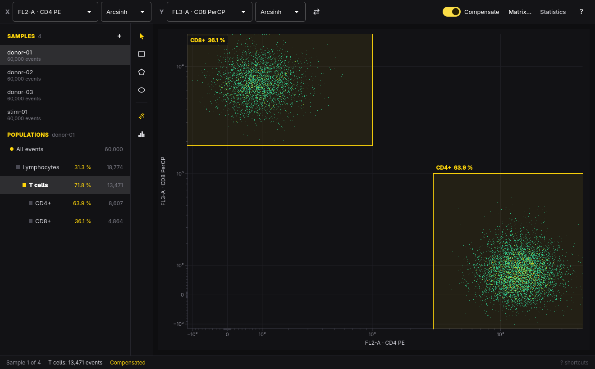

# Cyto



Gate flow cytometry data on Omarchy. Drop in FCS files, draw nested gates on
dot plots and histograms, compensate with the spillover matrix, and the same
gates apply to every sample, so the statistics table and its CSV export cover
the whole experiment. Cyto only ever reads your FCS files.

- **FCS 2.0, 3.0, and 3.1** in list mode: float, double, and integer data in
  either byte order, with log-amplified (`$PnE`) parameters expanded.
- **Dot plots** colored by density, and **histograms**, on linear, log, or
  arcsinh axes. Arcsinh keeps compensated values below zero visible.
- **Gates**: rectangles, polygons, ellipses, and ranges on histograms, nested
  as deep as you like. Move and reshape them with the mouse; a gate drawn to
  the plot's edge takes in the events piled up off scale.
- **Compensation** from the files' own `$SPILLOVER` matrix, which you can edit,
  or a matrix you start yourself.
- **Statistics**: events, % of parent, and % of total for every population in
  every sample; the CSV adds the median of every channel.
- **Workspaces** (`.cyto`) save the samples, gates, compensation, and the axes
  you used, as readable JSON.
- Follows the Omarchy theme and language, live.

## Keyboard

| Key | Action |
| --- | --- |
| `V` | Select, move, and reshape gates |
| `R` | Draw a rectangle gate (a range on a histogram) |
| `P` | Draw a polygon gate: click the corners, `Enter` to close |
| `E` | Draw an ellipse gate |
| Double-click, `Enter`, `→` | Look inside the selected gate |
| `←` | Up to the parent population |
| `↑` `↓` | Previous or next population |
| `Space` / `Shift + Space` | Next or previous sample |
| `X` / `Shift + X` | Next or previous X channel |
| `Y` / `Shift + Y` | Next or previous Y channel |
| `S` | Swap the axes |
| `L` / `Shift + L` | Cycle the X or Y scale: linear, log, arcsinh |
| `H` | Dot plot or histogram |
| `F2` | Rename the population |
| `Delete` | Delete the gate and the gates inside it |
| `C` | Compensation on or off |
| `Shift + C` | Edit the compensation matrix |
| `T` | Statistics table |
| `M` | Show % of parent, % of total, or events |
| `Ctrl + O` | Add FCS files |
| `Ctrl + Shift + O` | Open a workspace |
| `Ctrl + S` / `Ctrl + Shift + S` | Save the workspace / save as |
| `Ctrl + E` | Export the statistics as CSV |
| `Shift + Delete` | Remove the current sample from the analysis |
| `Ctrl + Z` / `Ctrl + Shift + Z` | Undo / redo |
| `Esc` | Cancel drawing, or deselect |
| `?` | Show every shortcut |
| `Q` | Quit (asks first when there are unsaved changes) |

## Command line

Every command but `open` runs without a display, for scripts and coding agents.

```sh
cyto open donor-*.fcs              # the window, with these samples
cyto open analysis.cyto            # or a saved workspace
cyto info donor-01.fcs --json      # channels, stains, value ranges, spillover
cyto check analysis.cyto --json    # every problem with a workspace
cyto stats analysis.cyto -o stats.csv           # apply the gates, write CSV
cyto stats analysis.cyto batch-2/*.fcs --json   # same gates, other samples
cyto skill install                 # teach Claude Code and Codex to use cyto
```

`cyto skill` prints the workspace format, including how gate coordinates map
onto each axis scale.

## Build

```sh
bin/build      # qmake6 + make into build/cyto
bin/test       # model, window, and command-line tests, offscreen
bin/install    # makepkg -fsi, so Cyto shows up in the app launcher
```

Set `CYTO_UI_SHOTS=<dir>` when running `bin/test` to keep a screenshot of each
window test.

## License

MIT. The theme watcher, translator, portal file picker, and command-line
structure are adapted from Omacut, Monologue, and Hype by David Heinemeier
Hansson, also MIT.
